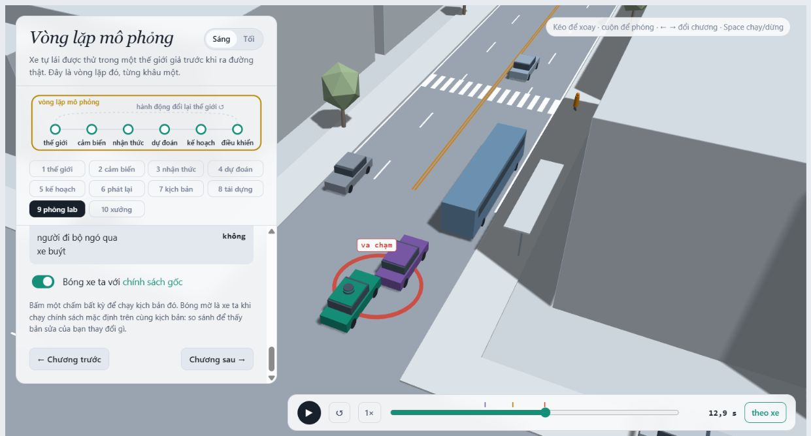
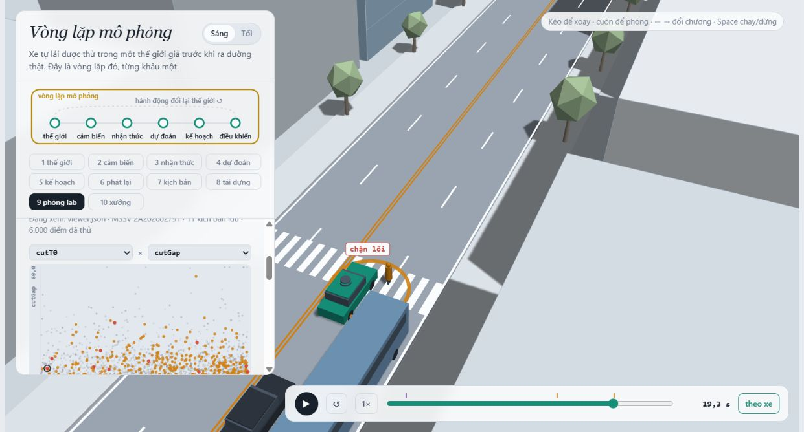
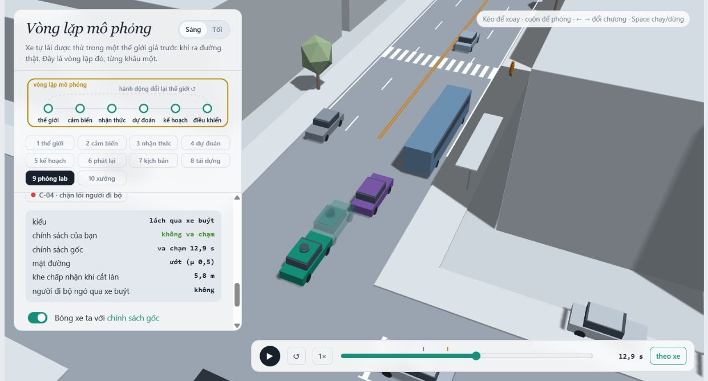
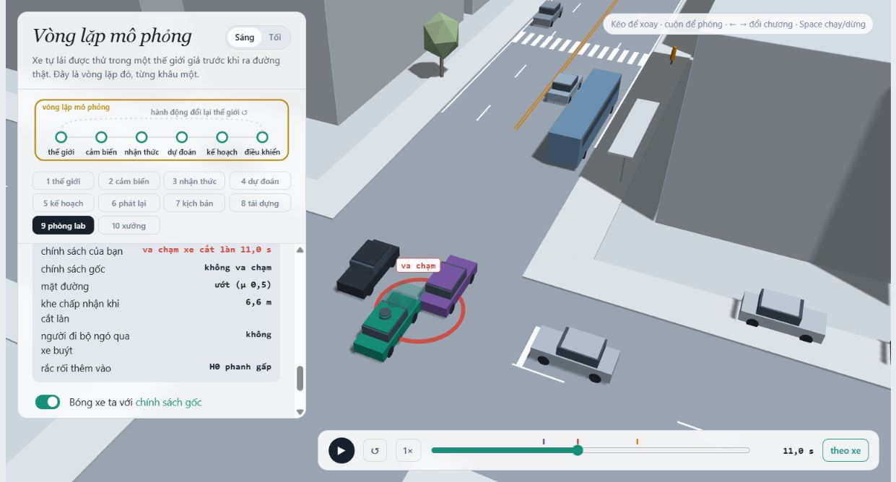

MSSV: 2A202602791

# Lab 11 · Scenario Forge — báo cáo

Thị trấn của bạn (`meta.json: _run.town`): A.

## 1. Phát lại log tạo va chạm giả (bước A)

`replay.json`: `n = 400`, `dropped_human_crash_logs = 0`, `n_used = 400`; `replay.crashes = 100` (`rear = 94`, `side = 6`, `front = 0`); `reactive.crashes = 1` (`front = 1`, `rear = side = 0`); `crash_in_both = 1`.

TG trong log tiếp tục chạy theo người lái đã ghi, trong khi planner giảm tốc ở thời điểm khác. Vì TG không phản ứng với việc planner phanh, nó chạm đuôi ego; đây là va chạm giả của phép phát lại. Thế giới phản ứng cho TG điều chỉnh theo ego nên có thể tránh được. Ví dụ `replay_only[0].scenario = 0`, tiếp xúc `rear`, nhưng thế giới phản ứng không va chạm và `min_ttc_reactive = 2.63576808448 s`.

## 2. Kịch bản bất khả thi (bước B)

`is_feasible` loại kịch bản nếu gia tốc ngang của chuyển làn cosin `(pi/cutDur)^2 * 3.5/2 > mu*9.81`, phanh sau nhập làn `cutBrake > mu*9.81`, người đi bộ `pedV > 2.5 m/s`, hoặc `cutV` ngoài `(0, 22] m/s`. Hai luật đầu giới hạn lực bám lốp; luật thứ ba giới hạn mô hình ở đi bộ, không chạy; luật cuối giữ xe chuyển làn ở dải tốc độ của lab. Thời gian chuyển làn không dương cũng bị loại.

`hunt.json: infeasible`: `bus_bypass = 3`, `cut_in = 0`, `crosswalk_block = 2`, `rear_ended = 9`; cuộc săn `rear_ended` loại nhiều nhất. Đối chiếu các hàng `out = infeasible` trong `cloud.json`, cả 9 hàng của cuộc săn này vượt giới hạn gia tốc ngang. Điểm nguy hiểm dễ kéo đề xuất về chuyển làn gắt, làm ego phải giảm tốc và xe bám đuôi tiến sát. Nếu chạy và đếm các hàng đó, ta cộng xác suất của tai nạn không thể xảy ra vào tỉ lệ lỗi; CEM còn học tập trung vào vùng vô lý, khiến ước lượng tăng sai. Pipeline đã bỏ chúng trước mô phỏng.

## 3. Monte Carlo và khoảng Wilson (bước C1)

`mc.json`: `crashes = 2`, `n = 3000`, `p = 0.000666666666667`; Wilson 95% `[0.000182839260378, 0.00242768454354]`, `infeasible = 15`. Các phiên bản bất khả thi không được chạy hay tính là va chạm; mẫu số pipeline vẫn là 3.000 lần rút tự nhiên.

Với p xấp xỉ p-hat, cần `n ≈ 96/p = 144000` lần rút để nửa độ rộng 95% xấp xỉ 20% của p. Đây là dự tính dựa trên chỉ hai vụ đã thấy, chưa phải bảo đảm ngân sách.

`modes.bus_bypass = 2`. `per_mode.cut_in.k`, `crosswalk_block.k`, `rear_ended.k`, `other.k` đều bằng 0, nhưng mỗi kiểu có Wilson `[0, 0.00127889566480]`. Báo cận trên này, không kết luận xác suất thật bằng 0; quy tắc ba cũng cho cận gần `3/3000 = 0.001`.

## 4. Importance sampling, ESS và độ suy biến (bước C3)

`estimate.json: seeds[s].per.<kiểu>` (mỗi hàng `n = 600`):

| Seed | Kiểu | p-hat / cận 95% khi chưa thấy | hits | ess | top_share |
|---:|---|---:|---:|---:|---:|
| 0 | bus_bypass | 0.00100766245 | 32 | 107.621514 | 0.404968489 |
| 0 | cut_in | ≤ 0.025 | 0 | 108.790045 | 0.000000000 |
| 0 | crosswalk_block | 7.02137959e-07 | 68 | 125.291685 | 0.327612648 |
| 0 | rear_ended | ≤ 0.025 | 0 | 118.081620 | 0.000000000 |
| 1 | bus_bypass | 0.000552380743 | 29 | 141.881417 | 0.350181785 |
| 1 | cut_in | ≤ 0.025 | 0 | 115.971520 | 0.000000000 |
| 1 | crosswalk_block | 2.90443128e-07 | 60 | 132.067278 | 0.258688190 |
| 1 | rear_ended | ≤ 0.025 | 0 | 123.121321 | 0.000000000 |
| 2 | bus_bypass | 0.00031538595 | 27 | 125.386352 | 0.382043124 |
| 2 | cut_in | ≤ 0.025 | 0 | 99.767801 | 0.000000000 |
| 2 | crosswalk_block | 2.88879766e-07 | 58 | 110.161234 | 0.259565268 |
| 2 | rear_ended | ≤ 0.025 | 0 | 125.240745 | 0.000000000 |

Seed 0, 1, 2 là nhãn trong file; hạt thực được pipeline lấy từ `meta.json: seeds.test = 1910196509` cộng lần lượt 0, 101 và 202. Với `cut_in` và `rear_ended`, cả ba seed có `hits = 0`; bảng báo `upper_zero_hits = 3/(0.2*600) = 0.025`, không suy ra xác suất thật bằng 0. `top_share = 0` ở các hàng này chỉ là quy ước khi chưa có đóng góp va chạm.

| Seed | total | lo | hi |
|---:|---:|---:|---:|
| 0 | 0.00100836458341 | 0.00012055500607 | 0.00317506982555 |
| 1 | 0.000552671186366 | 0.000116569797484 | 0.00226766824005 |
| 2 | 0.000315674829373 | 3.91079717606e-05 | 0.00187113735179 |

Các ước lượng điểm tổng chênh khoảng 3.19495 lần giữa seed 0 và 2; không ổn định đến mức có thể coi là cùng một con số chính xác. Cả ba vẫn nằm trong Wilson của Monte Carlo, và các khoảng xấp xỉ chồng nhau; hai vụ MC chưa đủ để xác nhận IS đúng. CEM có thể tập trung vào một vùng thất bại hiếm và bỏ sót vùng khác dù hỗn hợp phòng thủ giữ tính không chệch về lý thuyết.

Không có hàng nào `top_share > 0.5` trong ba seed này; lớn nhất là `seeds[0].per.bus_bypass.top_share = 0.404968489038`. Từng mẫu vẫn có thể đóng góp nhiều. Nếu top_share vượt 0.5 thì một mẫu mang hơn nửa tổng `sum(w*y)`, nên p-hat gần như do trọng số của mẫu đó chia n quyết định; se và khoảng chuẩn có thể gây tự tin sai. `top_share` nhỏ cũng không chứng minh đã phủ đủ vùng va chạm.

`budget = 16800`: 9.600 lượt rút của bốn cuộc săn và 7.200 lượt IS cho ba seed. MC cần khoảng 144.000 lượt cho mục tiêu ±20% đã tính ở câu 3, nhưng IS hiện cũng chưa đạt độ chính xác đó. Nếu chỉ so cùng se xấp xỉ của tổng, dùng `n_MC ≈ p_MC*(1-p_MC)/se_IS²` với `mc.json: p`, ta được lần lượt khoảng 3.247, 13.457 và 33.460 lượt MC cho seed 0, 1, 2 (tính từ các trường `se` trong bảng). Do đó không thể nói toàn bộ ngân sách IS luôn tiết kiệm hơn MC; các so sánh này còn chưa chứng nhận những kiểu zero-hit.

`other.source = mc.json`, `other.k = 0`, `other.n = 3000`, `other.hi = 0.00127889566480`. Đây là phần bù của phân hoạch kiểu va chạm, chưa có mục tiêu nguy hiểm riêng để săn. Không bỏ nó khỏi tổng; cũng không coi chưa thấy other là không có other. Khoảng tổng ±1.96*se là xấp xỉ và không thay thế các cận zero-hit của từng kiểu.

## 5. Các kiểu thất bại (bước C2 + 3D)

`hunt.json: found`: cuộc săn `bus_bypass` có 135 `bus_bypass`; cuộc săn `cut_in` có 25 `bus_bypass`; cuộc săn `crosswalk_block` có 29 `crosswalk_block`; cuộc săn `rear_ended` có 3 `crosswalk_block`. Hai kiểu tìm được có ảnh từ chương 9 nạp đúng `evidence/viewer.json` của MSSV này.

B-01 (`viewer.json: runs[id=B-01]`): xe buýt chặn làn ngoài; C2 chờ khe để lách vào làn ego, giảm tốc trong chỗ hẹp; ego nhận C2 là xe trước quá muộn và chạm C2. Ảnh ở 12.90 s, ngay sau khung tiếp xúc 12.85 s một bước 0.05 s. Thời điểm tiếp xúc được xác nhận bằng lần phát lại chẩn đoán bổ sung với `avsim.core.rollout` từ đúng params của B-01, ngoài các trường thống kê trong evidence.

C-01 (`viewer.json: runs[id=C-01]`): xe buýt che người đi bộ; P1 bắt đầu qua khi khe họ nhìn thấy đủ xa; ego nhận ra và dừng muộn, thân xe nằm trên vạch nên P1 phải đứng lại. Đây là `kind = block`, không phải người đi bộ đi xuyên thân xe. Ảnh đúng 19.25 s, khung block xác nhận bằng cùng cách phát lại chẩn đoán bổ sung.

Không cuộc săn nào tìm thấy `cut_in` hay `rear_ended` đúng nhãn. Tôi chỉ tin kết luận “chưa thấy ở ngân sách/seed này”, không tin chúng không thể xảy ra: MC và IS đều còn cận trên dương. Săn chung dễ chỉ lặp lách buýt và bỏ sót chặn lối; ngay cả săn riêng `cut_in` vẫn lệch sang lách buýt, còn săn `rear_ended` lệch sang chặn lối, như bảng found cho thấy.

## 6. Sửa planner (bước E + 3D)

`fix.json: chosen.policy = {"cutinLat": 2.6}`. Bộ chọn dùng TRAIN, yêu cầu tiến độ tối thiểu `0.95 * baseline_train.progress = 204.062447941 m`; các ứng viên cùng `fail_hi` được so bằng tiến độ. `cutinLat = 2.6` nhận xe lấn làn là xe trước sớm hơn mức gốc 2.15 m, có `chosen.progress = 214.861351788 m`, cao hơn hai ứng viên 3.0 và 3.3 cùng cận trên. Không chọn lại policy dựa trên TEST.

| Trường trong fix.json | fail | fail_hi_seen | fail_hi | progress (m) | harsh (khung/kịch bản) |
|---|---:|---:|---:|---:|---:|
| baseline_train | 0.000299406278618 | 0.000548317178178 | 0.000548317178178 | 214.80257678 | 8.48828125 |
| chosen | 3.99716843889e-07 | 7.11701415989e-07 | 7.11701415989e-07 | 214.861351788 | 8.19140625 |
| baseline_test | 0.00263211799866 | 0.00551497486539 | 0.00679387053019 | 213.71395816 | 8.553 |
| chosen_test | 2.99319962668e-05 | 8.6907806642e-05 | 0.00136580347145 | 213.639515874 | 8.51866666667 |

`progress` tính đến va chạm đầu tiên. `harsh` là số khung có gia tốc dưới -3 m/s², lấy trung bình trên các kịch bản; không phải số đợt phanh tách biệt. Mẫu tiến độ TRAIN có 256 lượt, TEST có 3.000 lượt (`_run.budgets.progress_n`, `mc_n`). Bản sửa giữ khoảng 99.9652% tiến độ TEST của baseline.

`chosen.unseen = [bus_bypass]` trên TRAIN, nhưng `chosen_test.unseen = []`: cuộc săn TEST mới đã tìm lại được thất bại. TEST cho ước lượng điểm và cận trên thấp hơn baseline trong lần này, không chứng nhận hết mọi lỗi. `chosen_test.bus_bypass.top_share = 0.971973444029`, `crosswalk_block.top_share = 0.887516840669`: mỗi ước lượng còn phụ thuộc mạnh vào một mẫu nặng, nên cần thận trọng với độ chính xác của ước lượng điểm. Cận TEST còn cộng bất định của va chạm khác: `chosen_test.other_crashes.k = 0`, `n = 3000`, `hi = 0.00127889566480`.

Trong lần chạy này `chosen_test.fail_hi = 0.00136580347145` nhỏ hơn `baseline_test.fail = 0.00263211799866`, nên tình huống cận bản sửa lớn hơn điểm baseline không xảy ra. Nó có thể xảy ra khi một kiểu bị loại mà TEST chưa thấy: dù chưa có hits, mỗi kiểu vẫn cộng `3/(0.2*400) = 0.0375`; 0 va chạm không đồng nghĩa đã chứng nhận xác suất rất nhỏ.

Ảnh so sánh phát lại B-01 tại 12.90 s: xe đặc dùng policy được chọn, bóng mờ dùng baseline; bản sửa không va chạm còn baseline va chạm. Phát lại chẩn đoán bổ sung bằng lõi mô phỏng, ngoài thống kê pipeline, xác nhận B-01–B-04 đều được cứu, còn C-01–C-04 vẫn có block. Trình xem dùng đúng params lưu trong `viewer.json` và policy từ `fix.json`; đây là đối chiếu từng cảnh, không phải một ước lượng xác suất mới.

Núm tưởng an toàn nhưng phản tác dụng trong TRAIN này: tăng `T` từ 1.6 lên 2.0 s (`table[8].policy`) làm `fail = 0.00104476877871`, `fail_hi = 0.00230165023348`, cao hơn baseline TRAIN. Giảm `cautionV` từ 7.5 xuống 6.5 m/s (`table[1]`) cũng làm `fail = 0.000950744090573` tăng. Thế giới phản ứng: khoảng trống ego để lại và thời điểm giảm tốc thay đổi lúc C2 chấp nhận khe, lách buýt và nhập làn; C2 có thể đi vào ngay trước ego ở vị trí đang phải chậm lại. Các số TRAIN phù hợp với cơ chế này; không thể suy rằng khoảng cách lớn hơn hoặc tốc độ thấp hơn luôn làm mọi tương tác an toàn hơn.

## 7. Từ mô phỏng ra đường thật

| Giả định trong `avsim/space.py` | Dữ liệu thật thay thế và nơi lấy | Hướng sai lệch cần kiểm tra |
|---|---|---|
| `cutGap` log-normal, trung vị 12 m ở thị trấn A; các tọa độ ẩn độc lập | Video drone hoặc camera cố định tại đoạn nhập làn cạnh trạm xe buýt; dựng quỹ đạo đồng bộ để đo khoảng hở khi xe thực sự bắt đầu nhập làn, kèm tốc độ và mật độ giao thông | Nếu xe thật chấp nhận khe nhỏ thường xuyên hơn giả định, mô phỏng có thể đánh giá thấp các va chạm khi nhập làn/lách buýt; cần đo lại tương tác chứ không chỉ thay trung vị. |
| Xác suất người đi bộ ngó qua xe buýt `pedLook = 0.85`, `pedGap` có trung vị 4.5 s | Camera nhiều góc ở trạm có vạch qua đường, ghi vị trí mắt, tầm nhìn bị che và khe xe khi người bắt đầu bước; kiểm tra thủ công các ca bị che | Nếu ít người ngó hơn hoặc chấp nhận khe ngắn hơn, nguy cơ bước ra muộn trước ego và chặn lối có thể cao hơn số báo. |
| Đường ướt có xác suất 0.20, ma sát chỉ nhận 0.5 hoặc 0.8 | Nhật ký mưa trên cùng tuyến ghép phép đo ma sát mặt đường bằng thiết bị đo độ bám hoặc dữ liệu ABS/IMU đã hiệu chuẩn của đội xe | Nếu đường thật trơn hơn 0.5 hoặc ướt thường hơn, khoảng dừng lớn hơn nên nguy cơ tăng ở các tình huống thiếu khoảng phanh. Tác nhân cũng thay đổi quỹ đạo, vì vậy không khẳng định mọi kiểu đều tăng đơn điệu. |

## 8. Giới hạn

Xác suất này không mô tả mọi tuyến đường: thế giới chỉ có một con phố, hình học và các tác nhân cố định trong 24 s. Nó không mô tả đủ hành vi con người: xe dùng IDM và luật khe chấp nhận, thiếu mất tập trung, thay đổi ý định và khác biệt thời gian phản ứng. Nó cũng không bao gồm đầy đủ lỗi nhận thức: planner dùng trạng thái mô phỏng và kiểm tra tầm nhìn, chưa truyền phân phối sai số nhận dạng, định vị hay độ trễ cảm biến vào điều khiển.

Nếu có thêm một tuần, tôi sẽ thu quỹ đạo tại một trạm xe buýt để hiệu chuẩn chung khe nhập làn, thời điểm người bước ra và mức che khuất; sau đó chạy nhiều seed trên một tập kiểm tra mới, tăng ngân sách cho các kiểu chưa thấy và kiểm tra độ nhạy với ma sát, độ trễ cảm biến. TRAIN và TEST vẫn được tách riêng.

## 9. Rắc rối của bạn (bước G + chương 10)

- **Rắc rối:** H0 buộc C2 phanh bất ngờ ở gần ego: mức phanh 6.5 m/s², kéo dài 2.5 s, sớm nhất ở giây 8 khi khoảng cách không quá 24 m. Tình huống tương ứng xe đang nhập làn/lách chướng ngại vật rồi người lái phát hiện cần dừng gấp; không giống phanh sau nhập làn nhẹ 1.5–4 m/s² trong phân phối tự nhiên.
- **Căn cứ:** planner dùng IDM và một ngưỡng ngang để nhận xe trước; khi C2 giảm tốc nhanh trong lúc lấn làn, quyết định nhận xe và khoảng dừng có thể không còn đủ. Cảnh gốc trong chương 10 không va chạm (`mine.json: exact.planner = []`), nhưng phép quét đã tìm ra lỗi, nên một lần thử cảnh gốc không đủ kết luận rắc rối an toàn.
- **Giả định:** `hazard.json: space` khảo sát `h0_decel = [4.5, 7.5]`, `h0_dur = [1.5, 3]`, `h0_trig = [10, 40]`. Cận phanh dựa vào ngưỡng phanh gấp khoảng 0.45g và giới hạn ma sát đường khô 7.848 m/s²; thời gian dựa vào khoảng dừng từ tốc độ 12–15 m/s; khoảng kích hoạt phủ hai phía của khoảng phanh khoảng 9–23 m. Đây là dải kiểm thử lấy đều, không phải phân phối đã đo. `exposure = 0.0858991521642124` lấy mức tham chiếu 1.155 sự kiện / 13.446 chuyến ở nhóm người lái mới không chở khách trong [Simons-Morton và cộng sự (2009), bảng 1](https://pmc.ncbi.nlm.nih.gov/articles/PMC3019610/). `why` nêu rõ giả định mỗi chuyến gặp một xe tương ứng C2; nguồn Mỹ này chưa xác lập tần suất Việt Nam hoặc riêng tình huống sau nhập làn.
- **Kết quả:** `mine.json: world = town`, `conditional_on = your town's traffic`, `accepted = 0.830666666667`: 1246/1.500 lượt khả thi, 254 lượt bị loại; không chồng lấn ở khung đầu (`overlap_at_start = 0`). Số dưới đây đều lấy từ các trường `baseline` và `chosen`:

| Policy | n | crashes | avoidable | unavoidable | unattributed | low_speed | avoidable_foreknown |
|---|---:|---:|---:|---:|---:|---:|---:|
| baseline | 1246 | 4 | 4 | 0 | 0 | 0 | 4 |
| chosen | 1246 | 2 | 2 | 0 | 0 | 0 | 2 |

| Policy | P(lỗi planner | rắc rối), p | Wilson lo | Wilson hi | per_trip | per_trip_hi |
|---|---:|---:|---:|---:|---:|---:|
| baseline | 0.00321027287319 | 0.00124907881722 | 0.00822540178897 | 0.000275759718023 | 0.000706555039882 |
| chosen | 0.0016051364366 | 0.000440287508928 | 0.00583378754186 | 0.000137879859012 | 0.000501117403752 |

Bản sửa giảm số lỗi từ 4 xuống 2 trên cùng mẫu, nhưng hai vụ của `chosen.examples` có params khác bốn vụ `baseline.examples`: nó vẫn tạo thất bại ở những cảnh baseline không va chạm. Cỡ mẫu có rất ít vụ, hai khoảng Wilson chồng nhau, nên chưa chứng minh một mức giảm chắc chắn.

Chỉ `avoidable` là lỗi theo chuẩn của lab: phanh hết cỡ ngay khi rắc rối đã bắt đầu và nhìn thấy giúp tránh mọi va chạm. `unavoidable` là phanh như vậy vẫn không cứu được; `unattributed` là va chạm không quy được cho H0. `low_speed` là cờ nằm trong các nhóm, không cộng lần nữa. Ở đây `avoidable_foreknown` bằng `avoidable`, không ghi nhận thêm vụ cứu được nhờ biết trước khi còn bị che. Chuẩn này lạc quan vì biết ngay khi thấy và phanh tối đa, nên có thể đếm nhiều hơn số lỗi một planner thực tránh được; ngược lại chỉ thử phanh, không đánh lái, nên có thể bỏ sót các vụ tránh được bằng điều hướng.

Tần suất lách buýt của policy gốc tham chiếu là trung vị `estimate.json: seeds[].per.bus_bypass.p = 0.000552380743239`. Rắc rối mới cho baseline `per_trip = 0.000275759718023`, khoảng một nửa mức tham chiếu đó. Với bản sửa, so `mine.json: chosen.per_trip = 0.000137879859012` với `fix.json: chosen_test.bus_bypass.p = 2.96228145791e-05`; rắc rối mới vẫn đáng quan tâm sau khi xử lý lách buýt. Phép nhân exposure chỉ là ngoại suy theo giả định chuyến đi và nguồn tham chiếu trong why, không phải tần suất tai nạn đo ngoài đường.

- **Hình:** GC-01 trong `viewer.json`, lấy từ `mine.json: chosen.examples[0]`: H0 bắt đầu và nhìn thấy từ 8.0 s (`fire_t = brake_t = 8.0`), bản sửa chạm C2 ở 11.0 s với `v_ego = 3.95355176926 m/s`. Bóng mờ baseline không va chạm trên chính cảnh này.

- **Tự lái:** đã thử chế độ Bạn trong trình xem và lưu chuỗi thao tác thật vào `hazard.json: egoAcc`: giữ tốc độ ban đầu trước giây 8, phanh -6 m/s² từ khung 160 trong 45 khung (2.25 s), rồi thả phanh. Python chạy lại cho `mine.json: exact.you = []`. Cảnh riêng này cả planner cũng không va chạm, nên không thể lấy nó làm bằng chứng người lái tốt hơn. Việc đã xem trước rắc rối cũng làm lần thử thuận lợi hơn phản ứng lần đầu ngoài đường.

- **Cách sửa:** tăng `cutinLat` đã cứu bốn vụ baseline nhưng không xoá lỗi H0. Chưa có núm nào được phép quét này chứng minh là sửa hết rắc rối; cần kiểm tra thêm `T`/`v0` trên TRAIN mới thay vì chọn bằng các vụ TEST đã thấy. Logic cần bổ sung là dự báo xe đang lấn làn có thể phanh gấp, kiểm tra khoảng hở so với khoảng dừng tại ma sát hiện tại và kích hoạt phanh khẩn cấp sớm, đồng thời kiểm tra xe bám đuôi. Chỉ nới ngưỡng ngang không giải quyết được thay đổi thời điểm C2 chấp nhận khe.
